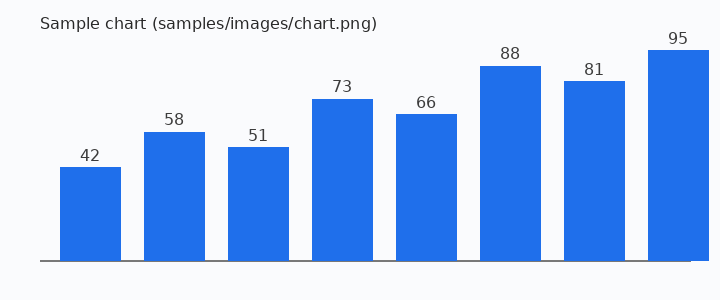

# qMDView 功能示範

這份文件用來測試 **qMDView** 的各項顯示功能。左側「目錄」面板會依標題自動產生大綱，點選即可跳轉；捲動時目前所在的章節也會同步反白。

## 文字格式

一般段落可以混用 **粗體**、*斜體*、~~刪除線~~ 與 `行內程式碼`。中英文混排 mixed text 也應該正常換行，行高設為 150% 讓中文比較好讀。

> 這是一段引用文字。
> 引用內的 [連結](https://www.qt.io) 會保留連結顏色。

## 清單

- 第一層項目
  - 第二層項目
    - 第三層項目
- 另一個項目

1. 編號清單
2. 第二點
3. 第三點

### 待辦清單

- [x] 讀取 Markdown 檔案
- [x] 檔案監看自動重載
- [ ] 匯出 PDF

## 程式碼

```cpp
// 圍欄式程式碼區塊會有底色與框線
int main(int argc, char *argv[])
{
    QApplication app(argc, argv);
    MainWindow w;
    w.show();
    return app.exec();
}
```

縮排式程式碼區塊：

    uint16_t crc = 0xFFFF;
    crc ^= data;

## 表格

| 項目 | 規格 | 備註 |
|:-----|:----:|-----:|
| 解析器 | md4c | Qt 內建 |
| 方言 | GitHub | 支援表格、待辦清單 |
| 編碼 | UTF-8 / Big5 | 自動偵測 |

## 圖片

相對路徑的圖片以 Markdown 檔所在資料夾為基準：



## 連結

- 外部網址：<https://doc.qt.io/qt-6/qtextdocument.html>
- 文件內錨點：[跳到「表格」](#表格)、[跳到「程式碼」](#程式碼)
- 其他 Markdown 檔：[second.md](second.md)、[second.md 的第二節](second.md#第二節)

---

## 結尾

修改並儲存這個檔案（用任何編輯器皆可），qMDView 會自動重新載入。
